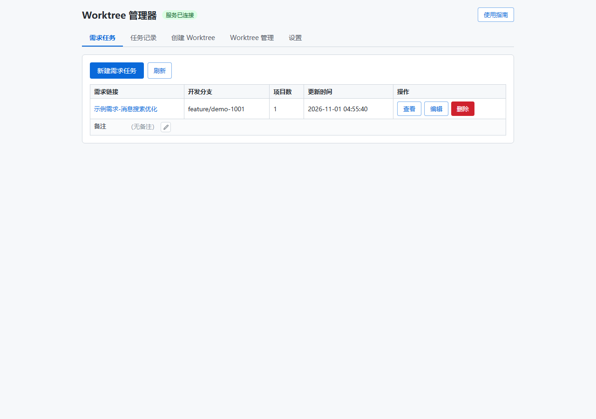
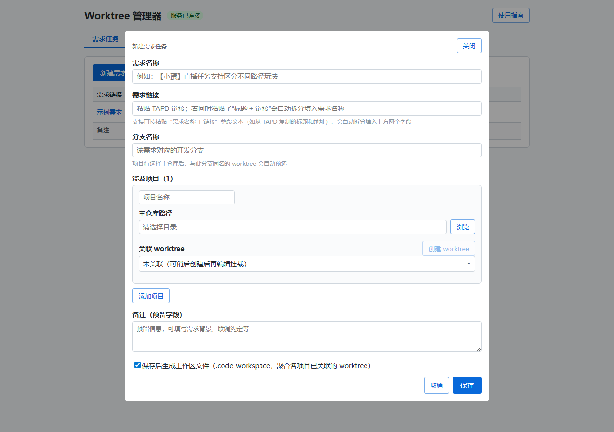
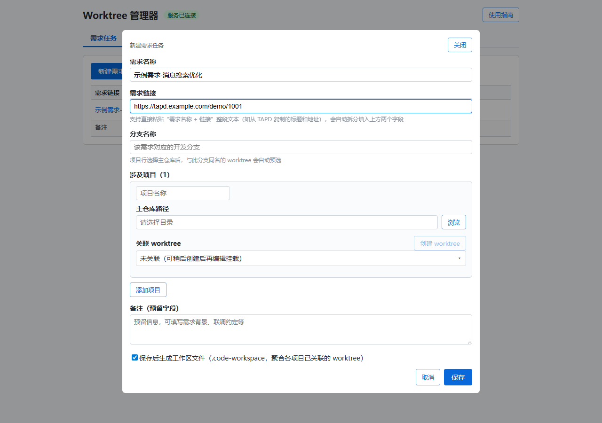
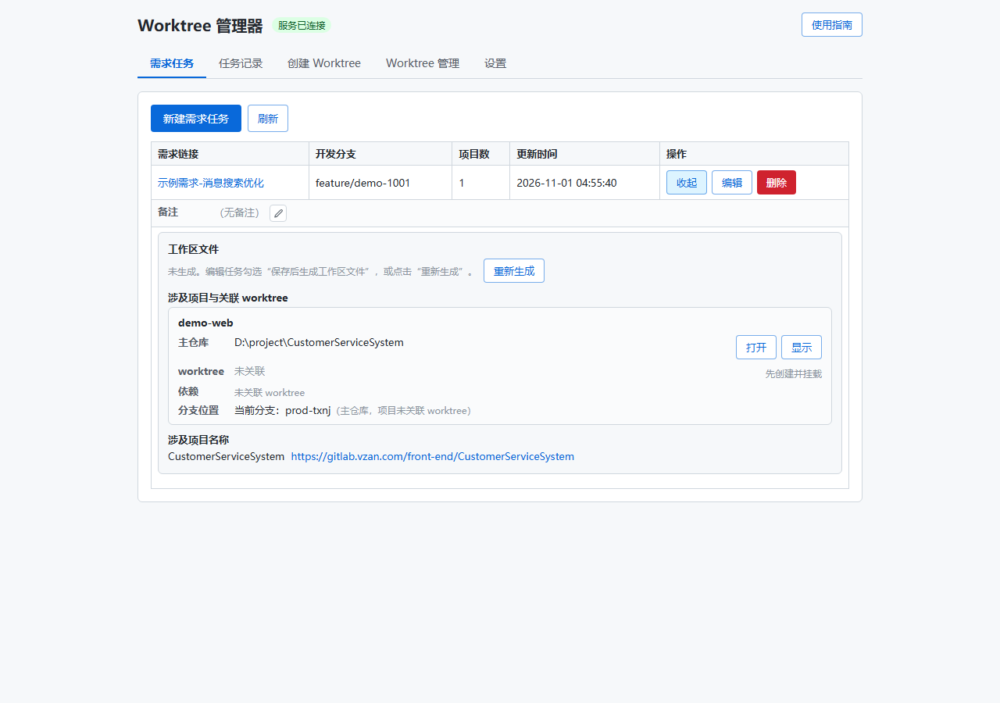
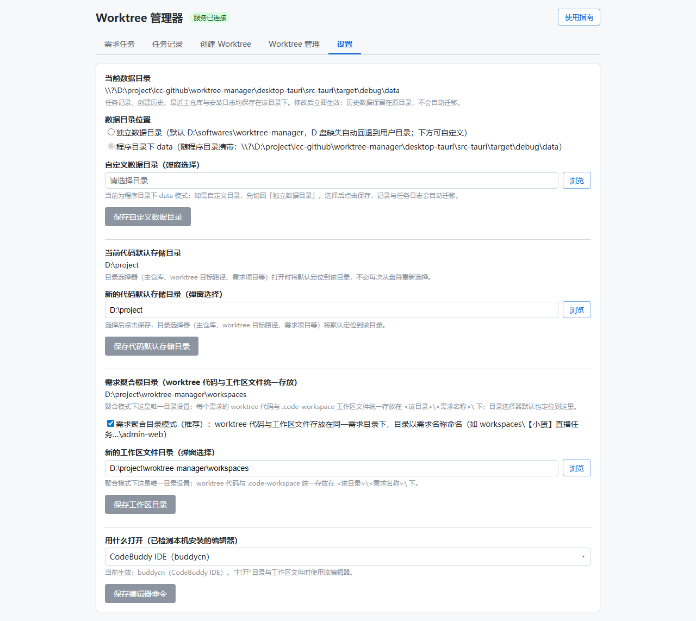

# 使用教程（图文）

> 以下截图即真实界面，源文件在 `docs/images/`。主文档见 [README](../README.md)。

## 需求任务页

### ① 任务列表

每个需求一行：需求链接（名称）、开发分支、项目数、更新时间与操作（查看 / 编辑 / 删除）。

### ② 新建需求任务

点击「新建需求任务」，填写需求名称、需求链接、开发分支，并添加涉及项目（选择主仓库目录后，项目名自动填入目录尾段）。

### ③ 粘贴自动解析

把 TAPD 复制的「需求名称 + 链接」整段粘到需求链接输入框，两个字段自动拆分填好，无需手动复制两次。

### ④ 查看明细

列表点「查看」展开明细，每个项目一张卡片：

- **主仓库**：路径 + 资源管理器定位
- **worktree**：关联目录 + 编辑器打开 / 资源管理器定位
- **依赖**：共享主目录 / 独立安装 / 未安装 / 高风险，一键「独立安装」「恢复共享」
- **分支位置**：当前实际分支与需求分支是否一致、有无未提交修改

底部附涉及项目名称与 git 网页链接。

## 设置页

- **数据根目录**：两种位置模式（独立数据目录 / 程序目录 data），立即生效、历史数据不迁移
- **代码默认存储目录**：主仓库目录选择器的默认定位（默认 D:\project）
- **需求聚合根目录 + 聚合模式开关**：开启后 worktree 代码与工作区文件统一存放在 <该目录>\<需求名称>\ 下
- **编辑器命令**：「打开」所用编辑器，自动探测本机已装应用（VS Code / CodeBuddy / Trae…），下拉选择

